# NF1AA3 — Informe d'auditoria de contrasenyes

**Alumne:** Daniel Gallardo  
**Cicle:** Sistemes Microinformàtics i Xarxes (SMX)  
**Mòdul:** Seguretat Informàtica  
**Data:** 10 de novembre de 2026

---

## 1. Objectiu de l'activitat

La pràctica consisteix a comprovar la seguretat de les contrasenyes d'un servidor Linux proporcionat per a l'activitat. L'objectiu és accedir a la màquina amb permisos d'administrador, obtenir els fitxers d'usuaris i hashes i analitzar-los des de Kali Linux amb **John the Ripper**.

Els fitxers utilitzats són `/etc/passwd`, que conté informació dels comptes del sistema, i `/etc/shadow`, que emmagatzema els hashes de les contrasenyes i altres dades relacionades. Aquests hashes no són contrasenyes en text pla: per trobar-ne una, John ha de provar candidats i comparar-ne els resultats.

## 2. Preparació de l'entorn

### 2.1. Màquines virtuals

S'utilitzen dues màquines a Oracle VirtualBox:

| Màquina | Sistema operatiu | Funció |
|---|---|---|
| `LinuxPasswords` | Ubuntu Server 24.04 | Servidor amb els usuaris que s'han d'analitzar |
| `kali-linux-2026.2-virtualbox-amd64` | Kali Linux | Equip des del qual s'executa l'auditoria |

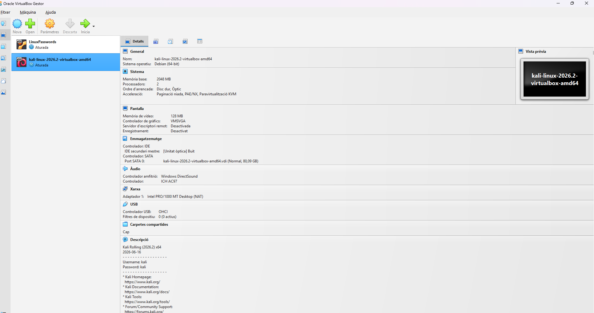

*Figura 1. LinuxPasswords i Kali Linux importats a VirtualBox.*

### 2.2. Configuració de xarxa

Els dos adaptadors es configuren com a **Xarxa NAT** i amb el nom `NatNetwork`, per tal que les màquines es puguin comunicar dins del laboratori.

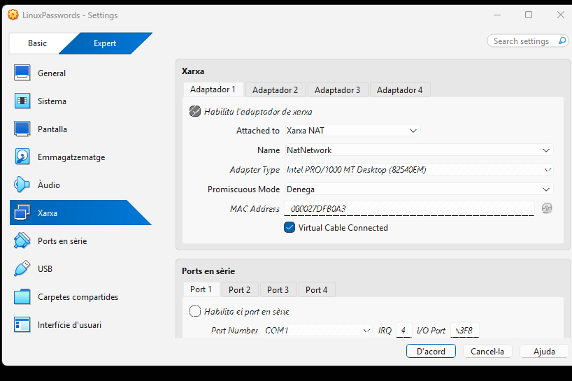

*Figura 2. Adaptador de xarxa del servidor.*

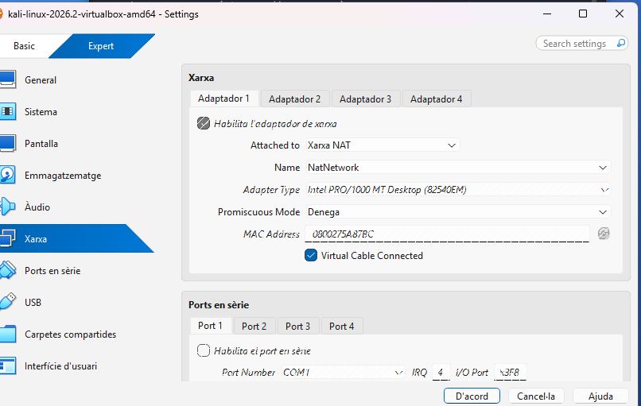

*Figura 3. Adaptador de xarxa de Kali Linux.*

Durant les comprovacions, les adreces utilitzades són `10.0.2.3` (Kali) i `10.0.2.4` (Ubuntu). La comunicació es verifica amb `ping` i el port SSH es comprova amb `nmap -p 22 10.0.2.4`.

## 3. Accés al servidor Linux

### 3.1. Mode de recuperació

Com que no es disposa de la contrasenya inicial del servidor, s'utilitza el menú **GRUB** per accedir al mode de recuperació. A `Advanced options for Ubuntu` es selecciona el kernel `6.8.0-44-generic (recovery mode)`, que és el que permet iniciar la màquina durant les proves.

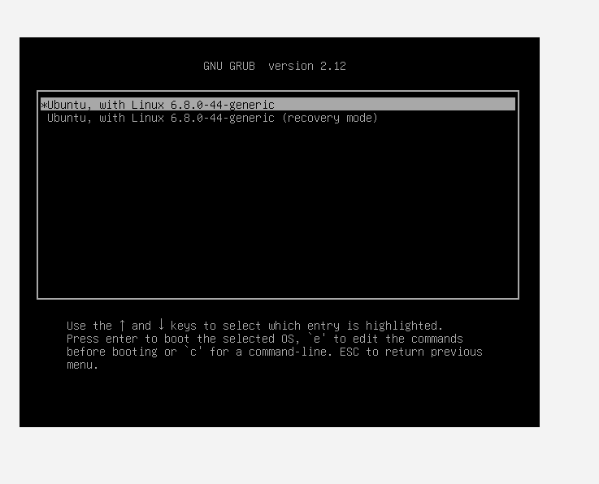

*Figura 4. Opció de recuperació del kernel utilitzat.*

Un cop dins de la consola de recuperació, es disposa d'accés `root`. Es remunta el sistema de fitxers amb permisos d'escriptura:

```bash
mount -o remount,rw /
```

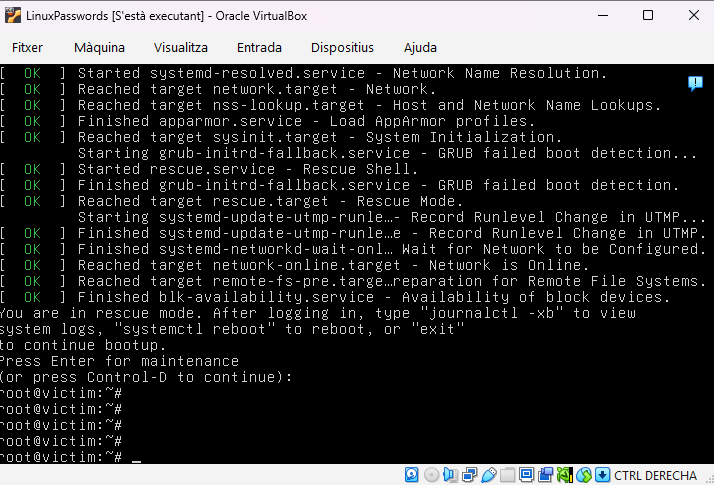

*Figura 5. Accés de manteniment amb permisos d'administrador.*

Aquesta part de la pràctica mostra el risc que suposa permetre modificar l'arrencada des de GRUB sense mesures de protecció, especialment si una persona pot accedir físicament a l'equip.

### 3.2. Preparació de SSH

Per transferir els fitxers a Kali es prepara el servidor OpenSSH a Ubuntu. En un primer moment no estava instal·lat i el port 22 apareixia tancat.

```bash
apt install openssh-server -y
systemctl start ssh
systemctl status ssh
```

Després de reparar una configuració de paquets que havia quedat interrompuda, el servei apareix com a **`active (running)`**.

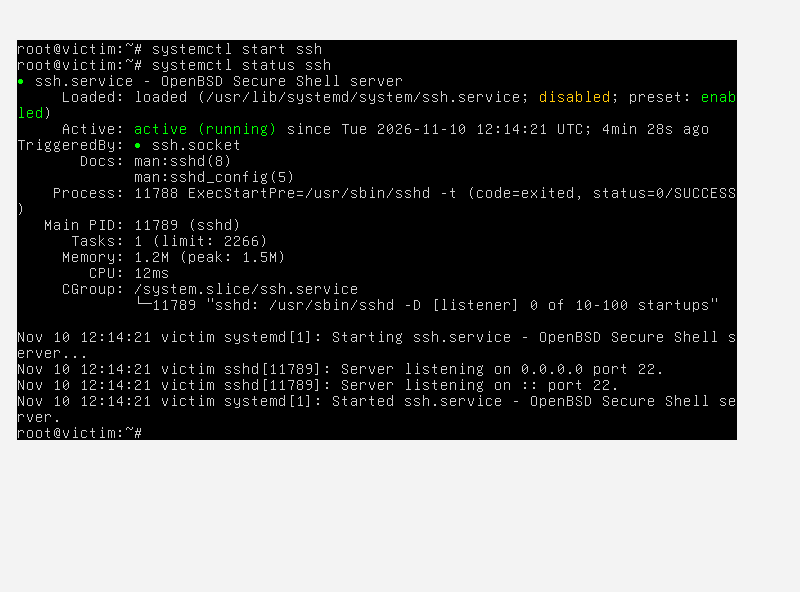

*Figura 6. OpenSSH actiu a LinuxPasswords.*

Des de Kali es comprova el port amb:

```bash
nmap -sV -p 22 10.0.2.4
```

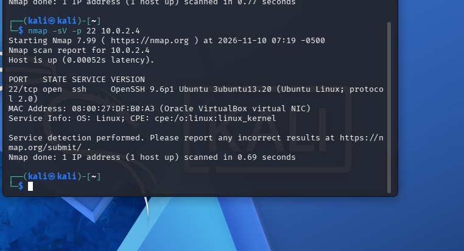

*Figura 7. El servidor respon al port 22.*

### 3.3. Connexió amb clau SSH

Per facilitar la connexió sense utilitzar les contrasenyes dels comptes originals, es crea un usuari de treball anomenat `auditoria` i una clau SSH a Kali.

A Ubuntu:

```bash
useradd -m -s /bin/bash auditoria
mkdir -p /home/auditoria/.ssh
chown -R auditoria:auditoria /home/auditoria/.ssh
chmod 700 /home/auditoria/.ssh
```

A Kali:

```bash
ssh-keygen -t ed25519 -f /home/kali/.ssh/auditoria_lab
```

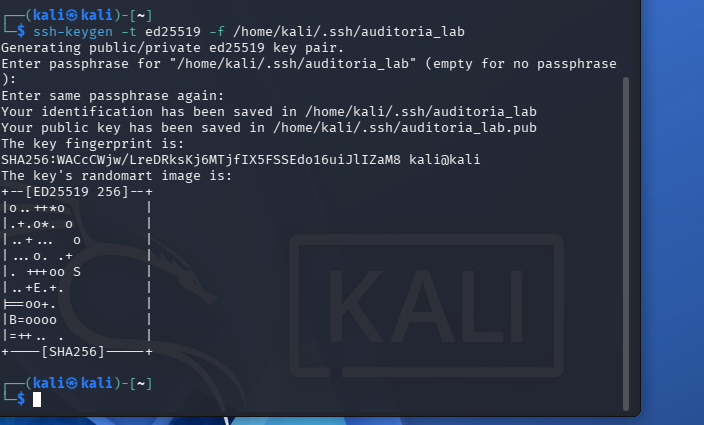

*Figura 8. Generació de la parella de claus SSH.*

La clau pública es copia al compte `auditoria` amb `ssh-copy-id`, després d'establir temporalment una contrasenya per a aquest usuari de treball:

```bash
ssh-copy-id -i /home/kali/.ssh/auditoria_lab.pub auditoria@10.0.2.4
```

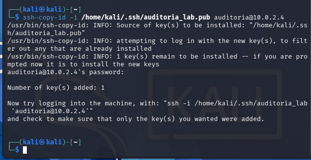

*Figura 9. Confirmació que s'ha afegit una clau pública.*

Finalment, es comprova la connexió:

```bash
ssh -i /home/kali/.ssh/auditoria_lab auditoria@10.0.2.4
```

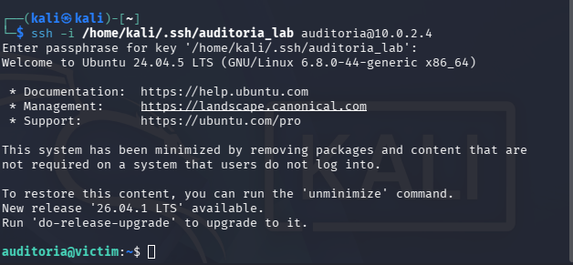

*Figura 10. Sessió remota iniciada des de Kali.*

El compte `auditoria` s'ha creat únicament per preparar la transferència i **no forma part dels sis usuaris originals que es volen revisar**.

## 4. Obtenció i transferència dels fitxers

### 4.1. Identificació d'usuaris

Al servidor es consulten els usuaris que disposen de directori personal:

```bash
getent passwd | grep '/home/'
```

En aquesta consulta apareixen els comptes originals `gru`, `bob`, `kevin`, `stuart`, `scarlet` i `herb`.

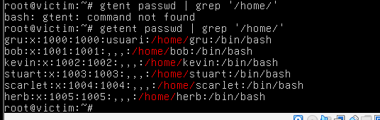

*Figura 11. Usuaris que consten al servidor de pràctiques.*

### 4.2. Comprovació de SCP

Abans de copiar els fitxers sensibles, es realitza una transferència de prova amb `prueba.txt` i es comprova que el contingut arriba correctament a Kali.

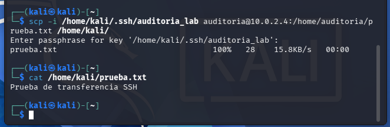

*Figura 12. Transferència d'un fitxer de text i verificació del contingut.*

### 4.3. Còpia de `passwd` i `shadow`

Des d'Ubuntu es preparen còpies dels fitxers a la carpeta del compte de treball. Els originals de `/etc/` es mantenen al seu lloc.

```bash
cp /etc/passwd /home/auditoria/passwd
cp /etc/shadow /home/auditoria/shadow
chown auditoria:auditoria /home/auditoria/passwd /home/auditoria/shadow
chmod 600 /home/auditoria/passwd /home/auditoria/shadow
```

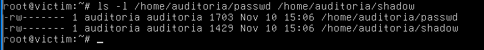

*Figura 13. Còpies protegides al directori de treball d'Ubuntu.*

A Kali, la transferència es fa mitjançant SCP i autenticació amb la clau creada:

```bash
scp -i /home/kali/.ssh/auditoria_lab auditoria@10.0.2.4:/home/auditoria/passwd /home/kali/auditoria/
scp -i /home/kali/.ssh/auditoria_lab auditoria@10.0.2.4:/home/auditoria/shadow /home/kali/auditoria/
```

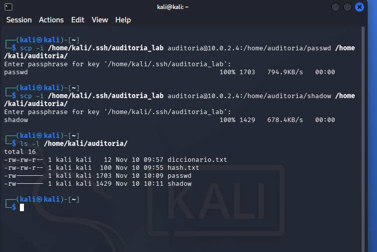

*Figura 14. Els dos fitxers es transfereixen correctament a Kali.*

### 4.4. Preparació amb `unshadow`

A Kali es protegeixen els fitxers i es crea un fitxer de treball que combina la informació dels usuaris amb els hashes:

```bash
chmod 600 /home/kali/auditoria/passwd /home/kali/auditoria/shadow
unshadow /home/kali/auditoria/passwd /home/kali/auditoria/shadow > /home/kali/auditoria/passwords-daniel
chmod 600 /home/kali/auditoria/passwords-daniel
```

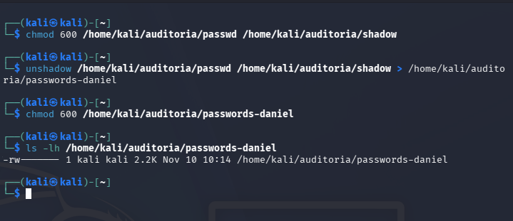

*Figura 15. Es crea el fitxer `passwords-daniel`, que s'utilitza en les proves següents.*

## 5. Proves amb John the Ripper

### 5.1. Atac bàsic — Single Crack

La primera prova consisteix a utilitzar el mode `--single`, que genera candidats a partir de dades del compte, especialment el nom d'usuari.

```bash
john --single /home/kali/auditoria/passwords-daniel
```

**Resultat:** John recupera la contrasenya del compte `gru`, que és precisament `gru`.

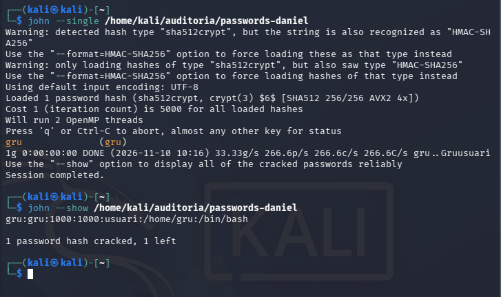

*Figura 16. Recuperació de la contrasenya del compte `gru`.*

Aquesta credencial és especialment feble perquè coincideix amb el nom de l'usuari; un atac bàsic la pot trobar sense necessitar cap diccionari extern.

### 5.2. Atac de diccionari — RockYou

El diccionari RockYou estava comprimit a Kali. Per preparar-lo es descomprimeix i es comprova que el fitxer `rockyou.txt` és accessible:

```bash
sudo gzip -d /usr/share/wordlists/rockyou.txt.gz
ls -lh /usr/share/wordlists/rockyou.txt
```

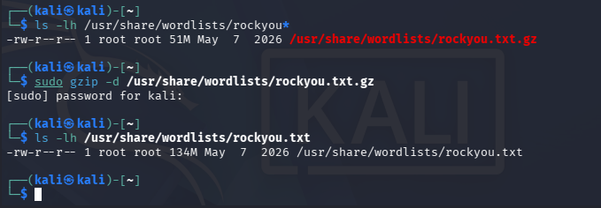

*Figura 17. Diccionari RockYou preparat per a la prova.*

S'executa:

```bash
john --wordlist=/usr/share/wordlists/rockyou.txt /home/kali/auditoria/passwords-daniel
```

John mostra el missatge **`No password hashes left to crack`**. Això passa perquè, amb la detecció automàtica de format utilitzada, només carrega el hash SHA-512 crypt que ja s'havia recuperat.

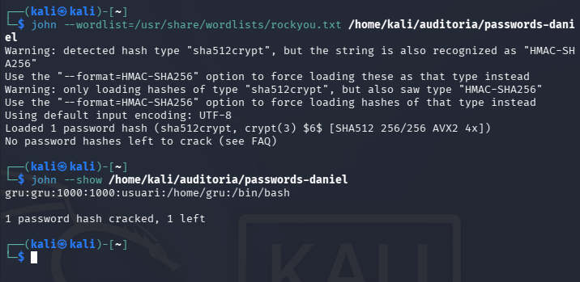

*Figura 18. John no executa noves comprovacions amb el diccionari.*

**Interpretació:** no es pot afirmar que RockYou hagi provat la contrasenya pendent ni que aquesta sigui resistent al diccionari. Caldria identificar-ne el format i tornar a fer l'anàlisi amb la configuració adequada.

### 5.3. Atac numèric — 4 a 8 dígits

El tercer mètode és un atac incremental limitat als números, amb longitud de 4 a 8 caràcters:

```bash
john --incremental=Digits --min-len=4 --max-len=8 /home/kali/auditoria/passwords-daniel
```

La sortida torna a mostrar **`No password hashes left to crack`**, de manera que tampoc no s'arriben a provar noves combinacions.

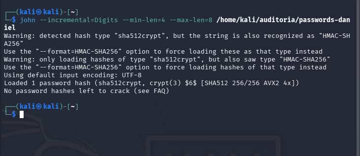

*Figura 19. Execució de la comanda incremental i missatge de John.*

Aquest resultat **no demostra** que el hash pendent resisteixi un atac numèric; només indica que no hi havia hashes pendents carregats per John amb aquell format.

### 5.4. Consulta dels resultats

La comanda per consultar les contrasenyes trobades és:

```bash
john --show /home/kali/auditoria/passwords-daniel
```

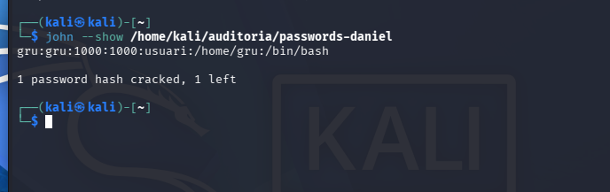

*Figura 20. Resultat final: un hash recuperat i un altre pendent.*

El resum retornat és **`1 password hash cracked, 1 left`**. És el resum dels hashes comptabilitzats per John, i no s'ha d'interpretar com si la resta dels sis usuaris originals tinguessin necessàriament contrasenyes recuperables o comprovades.

### 5.5. Prova complementària amb una contrasenya coneguda

Abans d'analitzar els fitxers originals del servidor, també es va fer una prova independent amb la contrasenya fictícia `Classe2026!`. Es va generar un hash SHA-512 crypt amb `openssl` i es va preparar un diccionari petit que contenia aquest valor conegut.

```bash
openssl passwd -6 -salt proves123 'Classe2026!' > /home/kali/auditoria/hash.txt
printf 'Classe2026!\n' > /home/kali/auditoria/diccionario.txt
john --format=sha512crypt --wordlist=/home/kali/auditoria/diccionario.txt /home/kali/auditoria/hash.txt
```

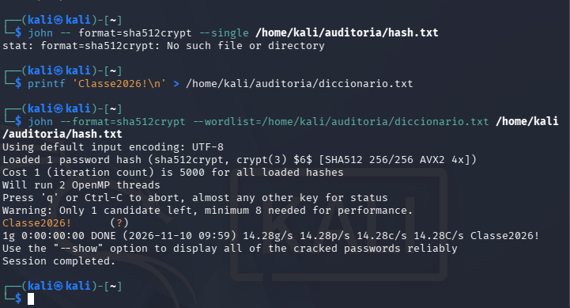

*Figura complementària. Recuperació d'una contrasenya coneguda a partir d'un hash de prova.*

Aquesta prova serveix per comprovar el funcionament de John the Ripper, **però no s'inclou en els resultats dels usuaris originals de LinuxPasswords**.

## 6. Verificació de la contrasenya recuperada

Per confirmar el resultat, es prova una connexió SSH amb l'usuari original `gru`:

```bash
ssh gru@10.0.2.4
```

La credencial recuperada, **usuari `gru` i contrasenya `gru`**, permet finalment iniciar la sessió. A la terminal apareix `gru@victim:~$`.

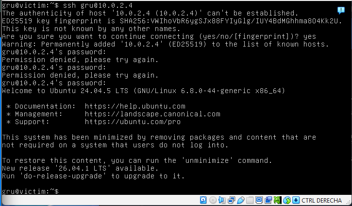

*Figura 21. Accés al servidor com a usuari `gru`.*

## 7. Resum de resultats

| Compte original | Contrasenya recuperada | Mètode | Verificació |
|---|---|---|---|
| `gru` | `gru` | Single Crack | Accés SSH confirmat |
| `bob` | No recuperada en aquesta pràctica | — | No realitzada |
| `kevin` | No recuperada en aquesta pràctica | — | No realitzada |
| `stuart` | No recuperada en aquesta pràctica | — | No realitzada |
| `scarlet` | No recuperada en aquesta pràctica | — | No realitzada |
| `herb` | No recuperada en aquesta pràctica | — | No realitzada |

**Important:** «No recuperada» no vol dir que s'hagi demostrat que la contrasenya sigui segura. Només indica que no hi ha cap recuperació acreditada per a aquell compte en les proves realitzades.

John ha informat d'un hash recuperat i d'un de pendent, però amb la informació de les captures no és possible associar el hash pendent a un usuari concret ni afirmar que tots els comptes s'han atacat amb tots els mètodes.

## 8. Incidències durant la pràctica

Durant la preparació s'han trobat alguns problemes que calia solucionar per poder continuar:

| Incidència | Solució aplicada |
|---|---|
| Error d'arrencada amb el kernel `6.8.0-147-generic` després d'actualitzar | Iniciar el kernel anterior `6.8.0-44-generic` des de GRUB |
| Configuració de paquets interrompuda | Executar `dpkg --configure -a` i completar la configuració de GRUB |
| SSH no instal·lat inicialment | Instal·lar `openssh-server` i iniciar el servei |
| Connexió de xarxa inestable o sense IP en mode recuperació | Revisar `NatNetwork`, DHCP i l'estat de la interfície `enp0s3` |
| Inici de sessió bloquejat en mode manteniment | Revisar la situació del servei i el bloqueig temporal de logins per preparar l'accés del compte de treball |

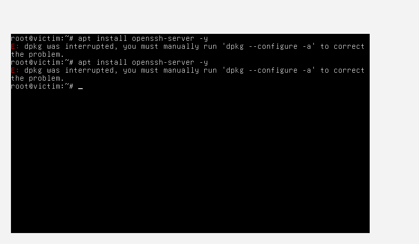

*Incidència: instal·lació bloquejada fins a executar `dpkg --configure -a`.*

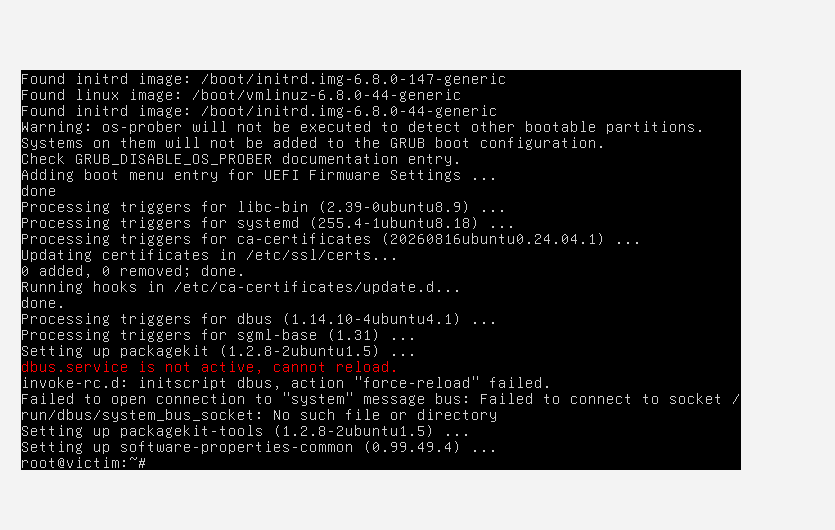

*Incidència resolta: configuració de paquets completada, amb avisos propis del mode de recuperació.*

Aquestes incidències expliquen per què la configuració ha requerit més passos dels previstos inicialment. La prova de cracking es realitza un cop recuperada la comunicació i transferits els fitxers.

## 9. Mesures de millora de seguretat

Les conclusions del laboratori permeten proposar diverses mesures per reduir el risc d'un atac similar:

1. **Contrasenyes robustes i úniques.** Evitar contrasenyes iguals al nom d'usuari, noms propis i patrons previsibles. Utilitzar un gestor de contrasenyes per generar claus llargues.
2. **Autenticació multifactor.** Activar-la als serveis que la permetin, especialment als accessos remots i comptes administratius.
3. **Protecció de l'arrencada.** Limitar l'accés físic a l'equip, protegir la configuració de GRUB i considerar el xifratge complet del disc perquè no sigui suficient entrar en mode recuperació per consultar dades sensibles.
4. **Accés SSH controlat.** Utilitzar claus protegides, restringir l'accés administratiu remot, limitar els usuaris autoritzats i revisar els registres d'autenticació.
5. **Protecció dels fitxers del sistema.** Evitar que `/etc/shadow` i les seves còpies quedin accessibles a usuaris o carpetes no autoritzats. Eliminar els fitxers temporals d'auditoria en acabar.
6. **Actualitzacions verificades.** Comprovar que les actualitzacions del sistema, el kernel i GRUB queden ben instal·lades abans de reiniciar un servidor.
7. **Auditories periòdiques.** Revisar les credencials i aplicar una política de seguretat per detectar contrasenyes febles abans que s'aprofitin en un incident real.

## 10. Conclusions

La pràctica ha permès configurar un entorn d'auditoria amb Kali Linux i Ubuntu Server, obtenir els fitxers necessaris i utilitzar John the Ripper sobre els hashes del servidor.

El resultat més clar és la recuperació de **`gru` / `gru`** amb el mode bàsic i la posterior verificació de l'accés SSH. Això confirma que una contrasenya igual al nom d'usuari és fàcil d'endevinar.

També s'han provat les comandes corresponents al diccionari RockYou i a l'atac incremental numèric, però John no ha fet noves comprovacions perquè no carregava hashes pendents del format detectat. Per aquest motiu, l'anàlisi de les altres contrasenyes queda limitada i no es poden treure conclusions sobre la seva robustesa.

Finalment, el treball mostra que protegir les contrasenyes no és suficient si es pot obtenir accés administratiu mitjançant el procés d'arrencada. És necessari combinar bones contrasenyes, controls d'accés, protecció del disc i una configuració segura del sistema.

## 11. Fonts

- Enunciat de l'activitat **NF1AA3 — Cracking de contrasenyes** (`README.md` del professor).
- Guia de classe **John the Ripper** (`guia_john.md`).
- [John the Ripper — documentació oficial](https://www.openwall.com/john/doc/).
- [Kali Linux — documentació de virtualització amb VirtualBox](https://www.kali.org/docs/virtualization/install-virtualbox-guest-vm/).

---

> **Nota sobre les evidències:** les captures corresponen a la pràctica real. Els fitxers de hashes i les claus privades no s'inclouen en aquest repositori. Les proves s'han limitat a la màquina virtual del laboratori.
