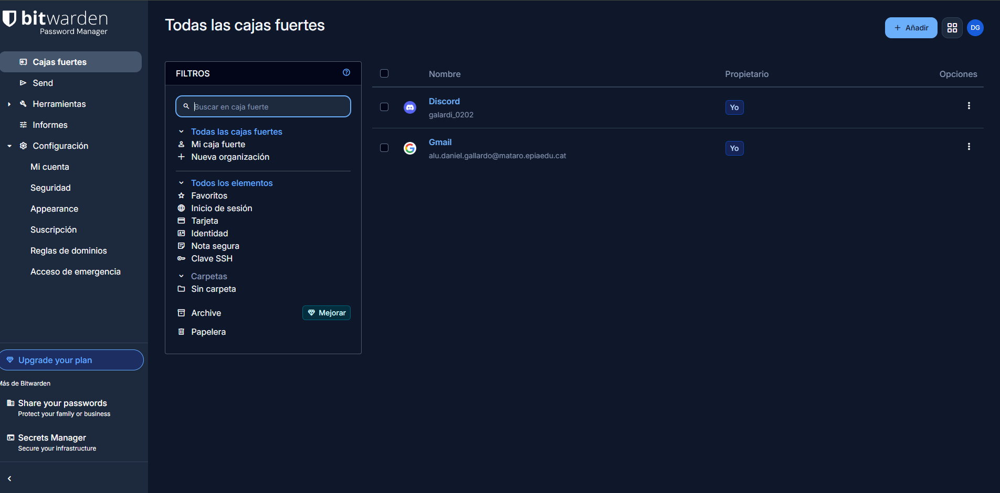
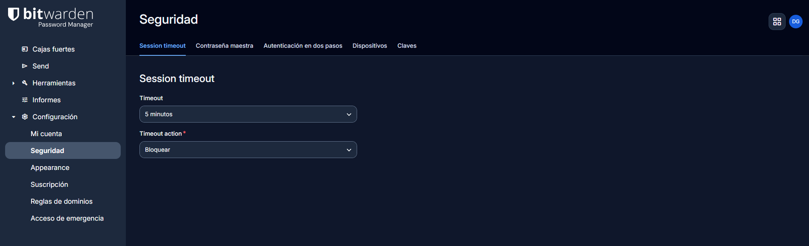
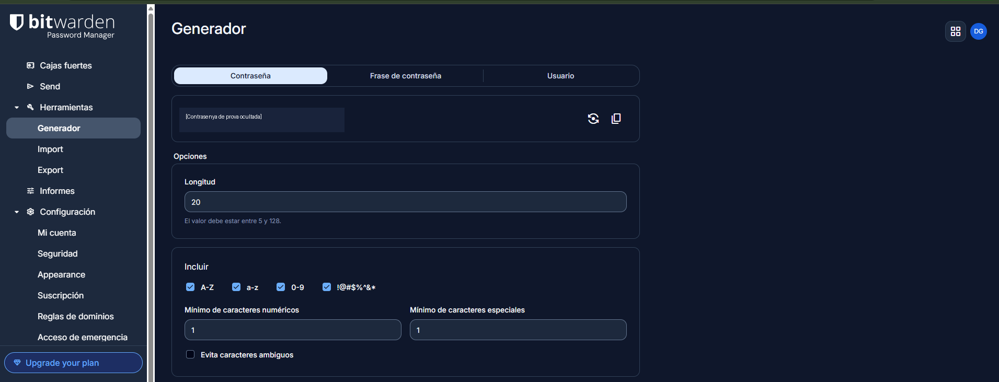
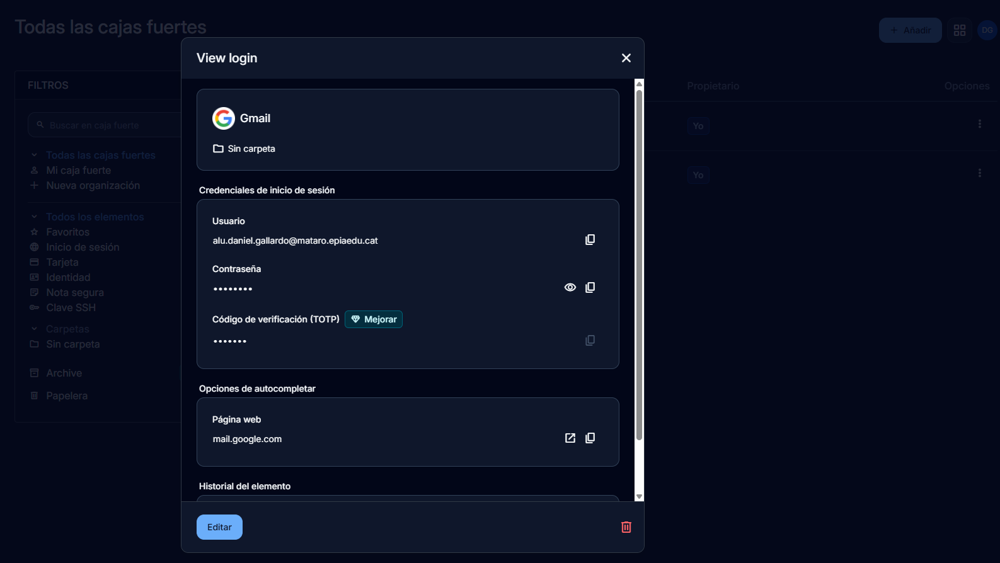
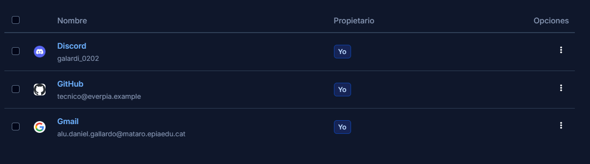
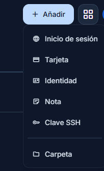
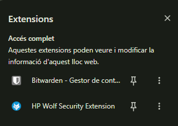
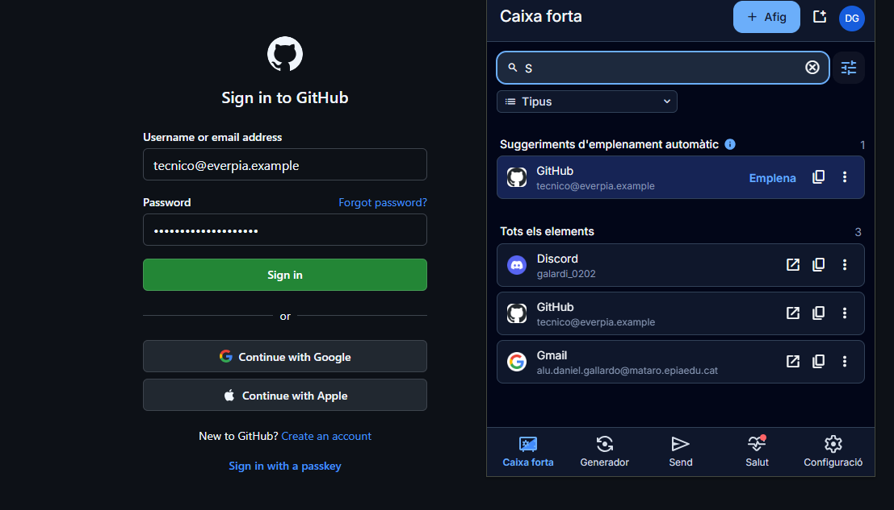
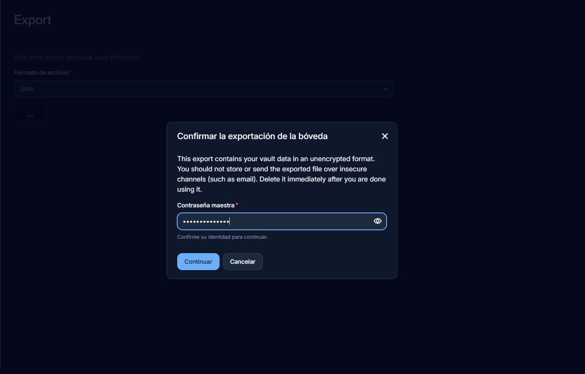
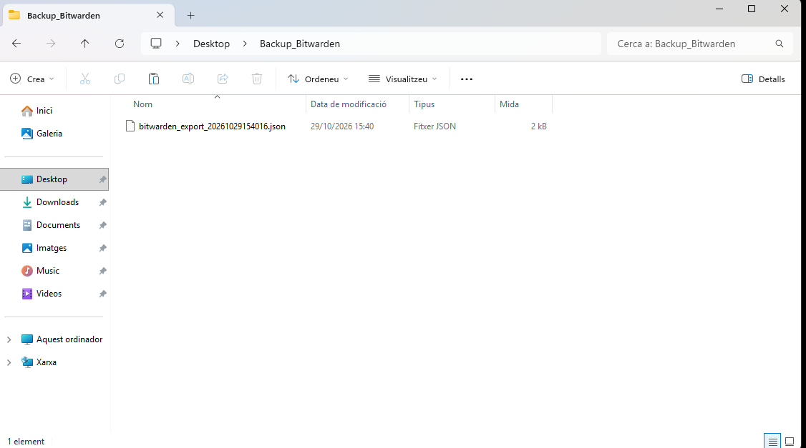

# 0226NF1.AA3 — Gestor de contrasenyes

## Fase 2. Guia d’ús tècnica de Bitwarden

**Empresa:** EverPia  
**Entorn:** Windows 11, aplicació web de Bitwarden i extensió del navegador  
**Eina seleccionada:** Bitwarden

## 1. Introducció

Aquesta guia explica l’ús de Bitwarden des del navegador: configuració del cofre, generació i emmagatzematge de contrasenyes, emplenament automàtic i còpies de seguretat. També es fa servir l’extensió del navegador, sense instal·lar l’aplicació d’escriptori.

## 2. Accés i configuració inicial

### 2.1. Accés al cofre

Per començar, s’accedeix a `https://vault.bitwarden.eu` amb el compte creat prèviament. A l’apartat **Cajas fuertes** es mostren les credencials desades.

### 2.2. Seguretat: bloqueig automàtic

1. Obrir **Configuración > Seguridad > Session timeout**.
2. Canviar **Timeout** de **15 minutos** a **5 minutos**.
3. Deixar **Timeout action** a **Bloquear**.
4. Desar els canvis si la interfície ho demana.

Això limita el temps que el cofre pot estar accessible sense activitat. La primera captura mostra la configuració anterior i la segona, la configuració aplicada.

## 3. Generació d’una contrasenya segura

1. Obrir **Herramientas > Generador**.
2. Seleccionar el tipus **Contraseña**.
3. Establir una longitud de **20 caràcters**.
4. Activar majúscules (**A-Z**), minúscules (**a-z**), números (**0-9**) i símbols.
5. Generar una contrasenya aleatòria.

Aquests paràmetres faciliten l’ús de contrasenyes llargues i diferents per a cada servei. A la captura s’ha ocultat el resultat concret del generador.

## 4. Emmagatzematge de credencials

### 4.1. Compte de correu electrònic

Per desar un compte de correu, cal entrar a **Cajas fuertes > Añadir > Inicio de sesión** i introduir el nom del servei, l’usuari, la contrasenya i la pàgina web associada. En aquest exemple s’ha desat una entrada de **Gmail**, amb la contrasenya oculta al cofre.

### 4.2. Servei web GitHub

Per al segon exemple, es crea una entrada de **GitHub** amb l’usuari fictici `tecnico@everpia.example`, una contrasenya diferent i l’adreça `https://github.com/login`. La captura mostra la nova entrada al costat de les altres credencials.

## 5. Extensió i emplenament automàtic

### 5.1. Extensió de Bitwarden

Per activar l’emplenament automàtic, cal instal·lar l’extensió oficial des de `https://bitwarden.com/download/` i iniciar-hi sessió amb el mateix compte. La captura mostra l’extensió instal·lada.

### 5.2. Prova amb GitHub

1. Obrir `https://github.com/login`.
2. Obrir l’extensió de Bitwarden.
3. Seleccionar GitHub a les **suggerències d’emplenament automàtic**.
4. Comprovar que el formulari mostra l’usuari i la contrasenya emplenats.

Com que l’usuari és fictici, **no es fa un inici de sessió real**. La prova demostra l’emplenament dels camps, no l’accés al servei.

## 6. Gestió de còpies de seguretat

### 6.1. Primera exportació i aspecte a corregir

A **Herramientas > Export** es va generar un fitxer amb les dades del cofre. La captura mostra que s’havia seleccionat el format **`.json` sense xifrar**. Bitwarden hi mostra un avís perquè aquesta exportació conté les dades sense xifrar.

**Aquesta còpia no és adequada com a còpia de seguretat definitiva de l’empresa.** Cal corregir aquest pas abans de donar per acabada la pràctica.

### 6.2. Procediment segur que s’ha d’aplicar

1. Anar a **Herramientas > Export**.
2. Seleccionar el format **`.json (Encriptado)`**.
3. Triar **`Protegido con contraseña`** (no l’opció restringida a un compte).
4. Introduir una contrasenya nova i robusta per a la còpia.
5. Confirmar l’exportació i descarregar el fitxer xifrat.
6. Eliminar la còpia anterior sense xifrar i qualsevol duplicat que s’hagi pogut crear.

> **Pendent de documentar:** inserir aquí una nova captura del format xifrat seleccionat, sense revelar la contrasenya.

### 6.3. Ubicació de la còpia

El fitxer descarregat es troba a la carpeta **`Backup_Bitwarden`**, creada a l’escriptori de Windows. La captura acredita la ubicació del fitxer, però **no demostra que estigui xifrat**.

Per a una empresa, es recomana guardar la versió xifrada en una **memòria USB xifrada** o en un emmagatzematge xifrat, amb accés limitat i una segona còpia separada. La contrasenya de desxifrat s’ha de custodiar en un lloc diferent.

Una comprovació completa del backup consistiria a provar-ne la importació en un cofre de proves autoritzat; aquesta prova no s’ha realitzat durant la pràctica.

## 7. Conclusions

Bitwarden facilita la creació de contrasenyes robustes i la gestió de diferents credencials des del navegador. La prova de GitHub mostra el funcionament de l’emplenament automàtic i la configuració de seguretat estableix el bloqueig del cofre als cinc minuts.

L’apartat de còpies de seguretat posa de manifest un risc important: **no n’hi ha prou amb exportar les contrasenyes; cal fer-ho amb xifratge i protegir també el fitxer descarregat**. Per completar correctament aquest apartat, cal repetir l’exportació en format xifrat.

## 8. Fonts

- [Bitwarden — Web oficial](https://bitwarden.com/)
- [Bitwarden — Descàrregues](https://bitwarden.com/download/)
- [Bitwarden — Generador](https://bitwarden.com/help/generator/)
- [Bitwarden — Emplenament automàtic](https://bitwarden.com/help/auto-fill-browser/)
- [Bitwarden — Exportacions xifrades](https://bitwarden.com/help/encrypted-export/)
