# Gestió d'emmagatzematge redundant — Part 1: LVM a Zorin OS

**Activitat:** Gestió d'emmagatzematge redundant (SMX)
**Empresa fictícia:** EverPia
**Sistema operatiu:** Zorin OS 18.1 Core 64 bits
**Eina principal:** LVM (Logical Volume Manager)
**Entorn:** VirtualBox

---

## Índex

1. [Objectiu](#1-objectiu)
2. [Preparació de la màquina virtual](#2-preparació-de-la-màquina-virtual)
3. [Instal·lació de Zorin OS](#3-instal·lació-de-zorin-os)
4. [Volums físics (PV)](#4-volums-físics-pv)
5. [Grup de volums (VG)](#5-grup-de-volums-vg)
6. [Volum lògic (LV) lvl](#6-volum-lògic-lv-lvl)
7. [Format i muntatge manual](#7-format-i-muntatge-manual)
8. [Muntatge automàtic amb /etc/fstab](#8-muntatge-automàtic-amb-etcfstab)
9. [Volum mirall (lvm_mirror)](#9-volum-mirall-lvm_mirror)
10. [Volum lvm_dades, snapshot i restauració](#10-volum-lvm_dades-snapshot-i-restauració)
11. [Ampliació de lvm_dades](#11-ampliació-de-lvm_dades)
12. [Resum de la part de Linux](#12-resum-de-la-part-de-linux)

---

## 1. Objectiu

Dissenyar i documentar una solució d'emmagatzematge redundant per a un servidor Linux, usant LVM. La solució ha de permetre:

- Crear volums lògics sobre diversos discs físics.
- Protegir la informació davant la fallada d'un disc (mirall).
- Fer instantànies (snapshots) i restaurar-les.
- Ampliar un volum utilitzant l'espai lliure del grup.

## 2. Preparació de la màquina virtual

La màquina es diu `EverPia-Zorin-LVM` i té aquestes característiques:

- Zorin OS 18.1 Core 64 bits, amb 4096 MB de RAM i 2 processadors.
- Controlador SATA en mode AHCI.
- Disc principal de 25 GB (`/dev/sda`).

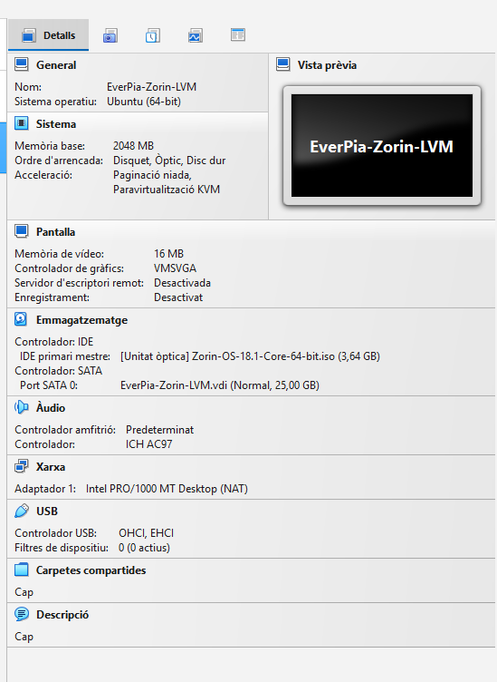

Per a LVM calen discs addicionals de 10 GB. Es creen des de **VirtualBox → Configuració → Emmagatzematge → Controlador SATA → Afegir disc dur**, amb aquests paràmetres:

- Tipus: **VDI**.
- Emmagatzematge: **dinàmicament reservat**.
- Mida: **10 GB**.

Cada disc nou es connecta a un port SATA diferent. Els dos primers discs són `EverPia-LVM-Disco1` i `EverPia-LVM-Disco2`.

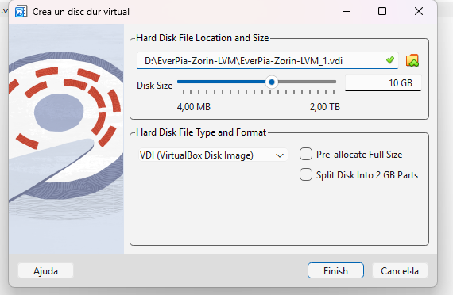

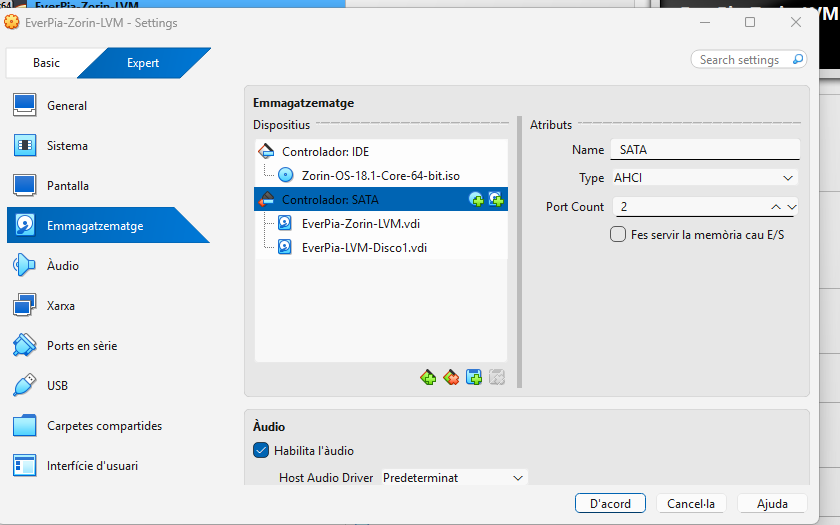

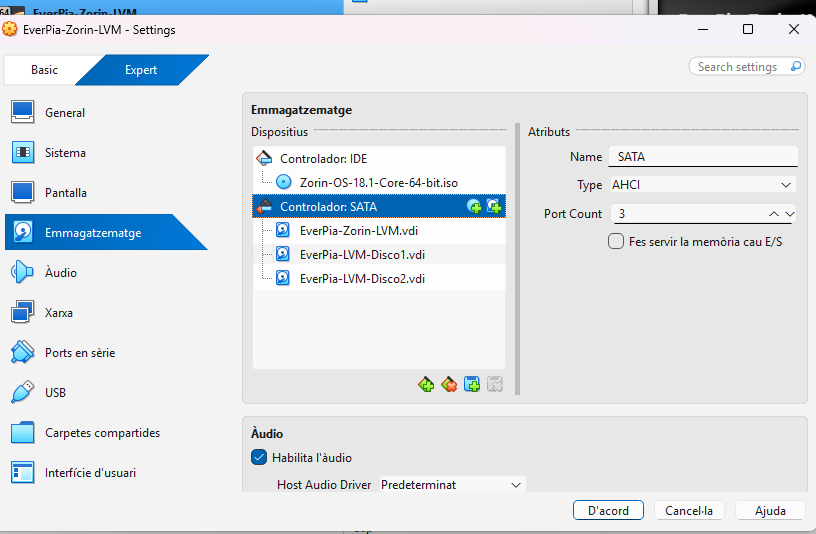

> **Incidència:** en crear el tercer disc, l'assistent proposava una mida de 25 GB, que és la del disc principal. Es va canviar a 10 GB abans de confirmar-ho.

## 3. Instal·lació de Zorin OS

S'instal·la Zorin OS des de la ISO en el disc principal de 25 GB. A la pantalla de particions es crea una partició `ext4` amb el punt de muntatge `/`.

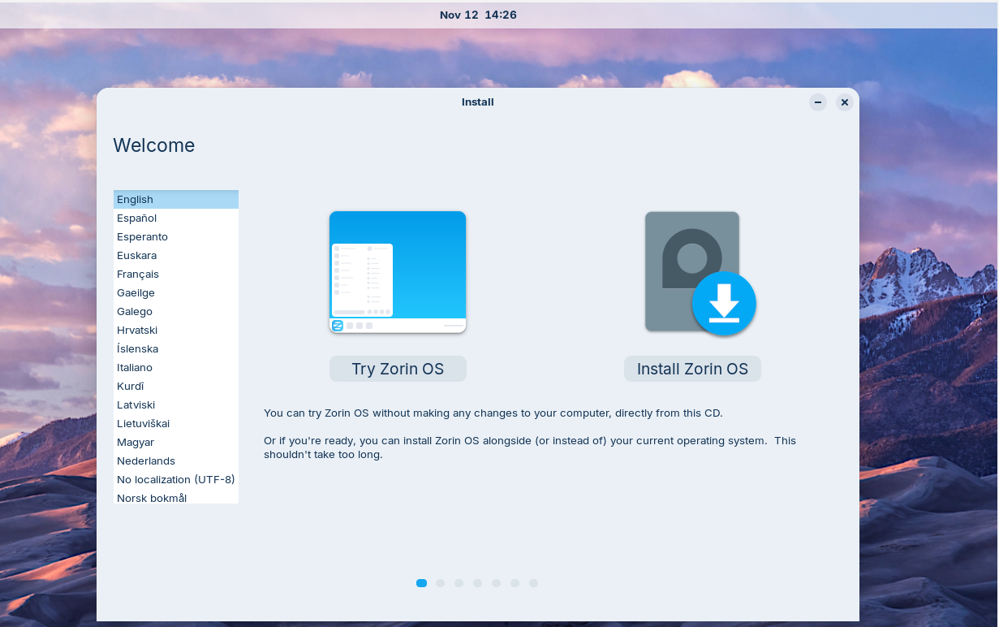

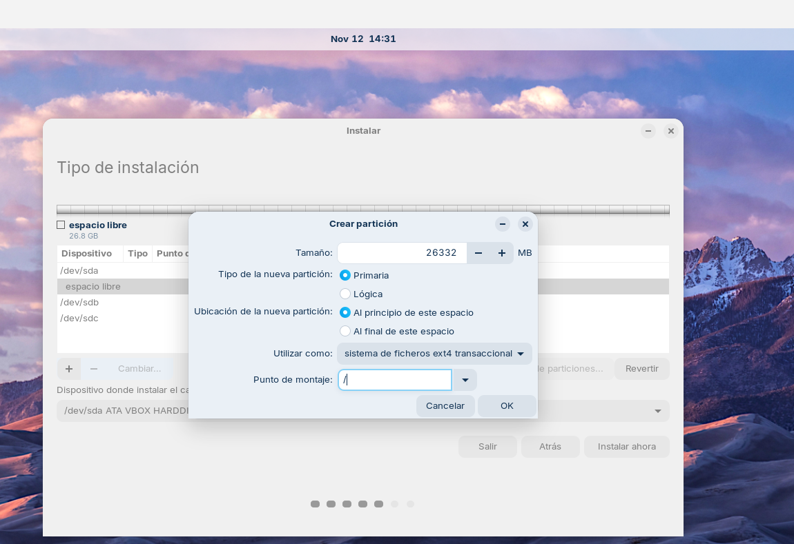

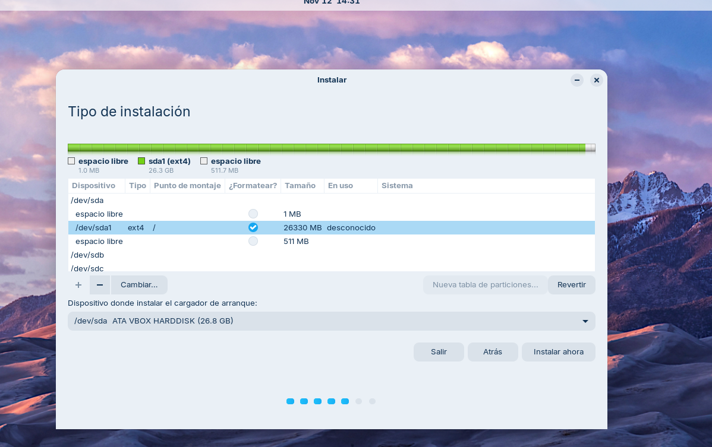

## 4. Volums físics (PV)

Primer comprovem quins discs tenim disponibles:

```bash
lsblk
```

- `lsblk` mostra els discos i les particions amb la seva mida.
- `sda` és el disc del sistema, que no toquem. `sdb` i `sdc` són els discos de 10 GB que volem usar.

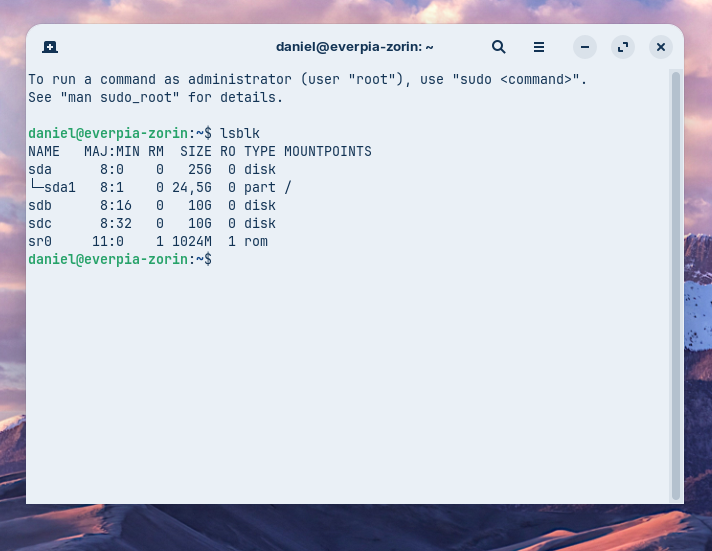

Després convertim cada disc en un volum físic (PV) de LVM:

```bash
sudo pvcreate /dev/sdb
sudo pvcreate /dev/sdc
sudo pvs
```

- `pvcreate` escriu la capçalera de LVM al disc, perquè pugui ser utilitzat per a un grup de volums.
- `pvs` mostra un resum dels volums físics existents.

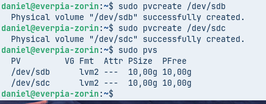

## 5. Grup de volums (VG)

Creem el grup de volums `vg1` amb els dos volums físics:

```bash
sudo vgcreate vg1 /dev/sdb /dev/sdc
sudo vgs
```

- `vgcreate` crea un grup de volums amb un nom i els PV que hi afegim. El grup és l'espai comú del qual després sortiran els volums lògics.
- `vgs` mostra un resum del grup.

El resultat és un grup amb 2 PV i uns 19,99 GB de capacitat.

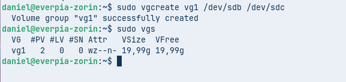

## 6. Volum lògic (LV) lvl

Creem un volum lògic de 2 GB dins de `vg1`:

```bash
sudo lvcreate -L 2G -n lvl vg1
sudo lvs
```

- `lvcreate` crea un volum lògic.
- `-L 2G` indica la mida del volum.
- `-n lvl` indica el nom del volum. **La última lletra és una ele minúscula**, no un número.
- `vg1` és el grup on es crea.
- `lvs` mostra els volums lògics existents.

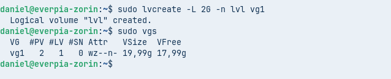

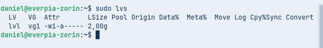

### Error habitual: confondre `lvl` amb `lv1`

En intentar formatar el volum, el comando amb número `1` no troba el dispositiu:

```bash
sudo mkfs.ext4 /dev/vg1/lv1
```

El sistema respon que el fitxer no existeix i demana una mida. Això passa perquè `mkfs` no troba el dispositiu `/dev/vg1/lv1` i intenta crear-lo com a fitxer. El volum existeix, però es diu `lvl`.

Per comprovar el nom real s'usa `ls -l /dev/vg1/`, que mostra l'enllaç simbòlic del volum:

```bash
ls -l /dev/vg1/
```

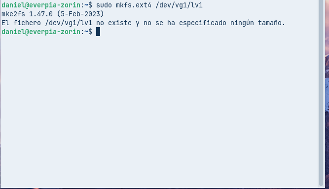

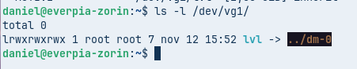

## 7. Format i muntatge manual

Un cop comprovat el nom, formatem el volum amb ext4:

```bash
sudo mkfs.ext4 /dev/vg1/lvl
```

- `mkfs.ext4` crea un sistema de fitxers ext4 dins del volum.

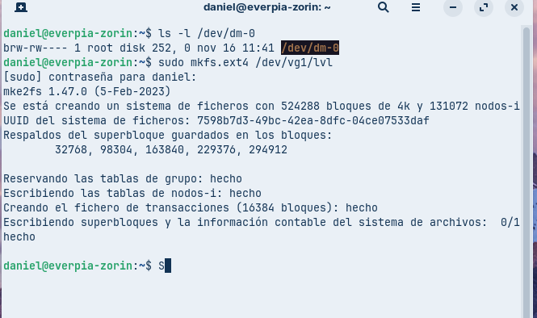

Creem la carpeta de muntatge i muntem el volum:

```bash
sudo mkdir /mnt/lvm
sudo mount /dev/vg1/lvl /mnt/lvm
df -h /mnt/lvm
```

- `mkdir` crea la carpeta `/mnt/lvm`, que servirà de punt de muntatge.
- `mount` connecta el volum a la carpeta.
- `df -h` mostra l'espai ocupat i lliure del sistema de fitxers.


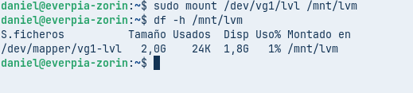

## 8. Muntatge automàtic amb /etc/fstab

El muntatge manual es perd en reiniciar. Per fer-lo automàtic s'afegeix una línia a `/etc/fstab`.

Abans de modificar el fitxer en fem una còpia de seguretat:

```bash
sudo cp /etc/fstab /etc/fstab.bak
ls -l /etc/fstab*
```

- `cp` copia el fitxer.
- `ls -l /etc/fstab*` comprova que existeixen els dos fitxers.

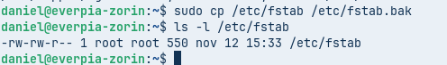

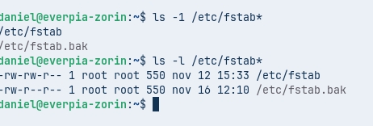

Obrim el fitxer amb `nano`:

```bash
sudo nano /etc/fstab
```

Aquest és el contingut original, amb les línies de l'arrel i de `swapfile`:

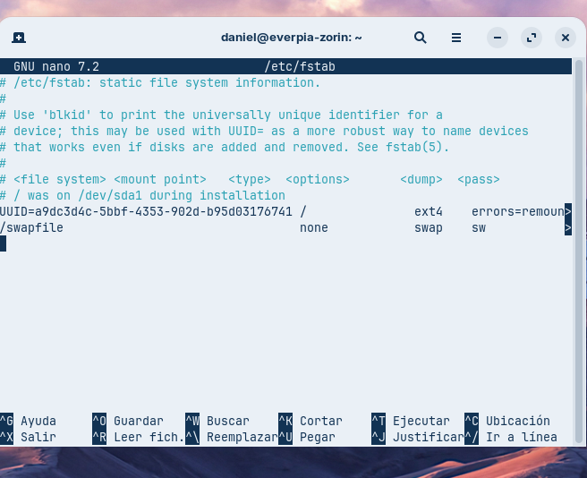

Afegim al final la línia del volum:

```text
/dev/vg1/lvl /mnt/lvm ext4 defaults 0 0
```

- `/dev/vg1/lvl` és el volum.
- `/mnt/lvm` és el punt de muntatge.
- `ext4` és el tipus de sistema de fitxers.
- `defaults` són les opcions habituals.
- Els dos zeros indiquen que no es fan còpies de seguretat amb `dump` ni comprovacions amb `fsck` a l'arrencada.

Es guarda amb **Ctrl+O** i després es surt amb **Ctrl+X**.

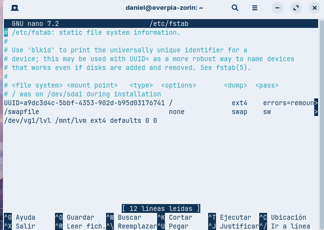

Per comprovar que la línia és correcta sense reiniciar, es fa:

```bash
sudo mount -av
```

- `-a` intenta muntar tots els volums de `fstab`.
- `-v` mostra el resultat de cada volum.

Com que `/mnt/lvm` ja estava muntat, el resultat és "ya está montado". No apareix cap error de sintaxi.

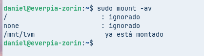

Després del reinici de la màquina, `lsblk` mostra `vg1-lvl` muntat a `/mnt/lvm` sense haver-lo muntat a mà.

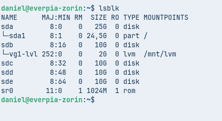

## 9. Volum mirall (lvm_mirror)

El mirall guarda una còpia de les dades en un segon disc, de manera que si un disc falla, la informació es manté.

> **Decisió:** la guia del professor crea el mirall en un grup nou, `vg_mirror`, amb dos discs. Els discs `sdb` i `sdc` ja formen part de `vg1`, i un disc només pot estar en un grup. Per això afegim **dos discs nous** (`EverPia-LVM-Disco3` i `EverPia-LVM-Disco4`, que apareixen com a `sdd` i `sde`) i creem el grup `vg_mirror` amb ells.

Discs afegits, connectats al controlador SATA:

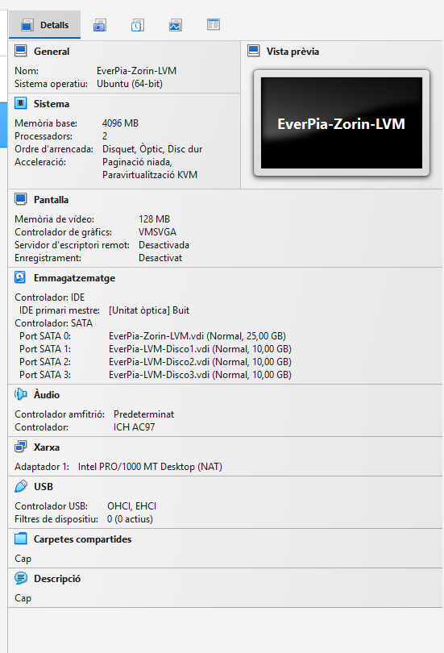

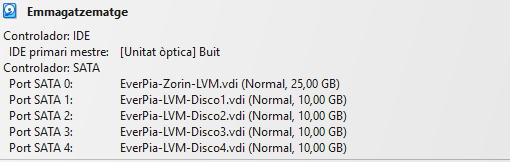

Els dos discs nous apareixen sense particions:


Preparem els dos discs com a volums físics i creem el grup:

```bash
sudo pvcreate /dev/sdd
sudo pvcreate /dev/sde
sudo vgcreate vg_mirror /dev/sdd /dev/sde
```

- `vgcreate` crea el grup `vg_mirror` amb els dos volums físics.

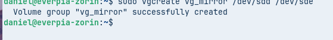

Creem el volum mirall amb una còpia:

```bash
sudo lvcreate -L 750M -m 1 -n lvm_mirror vg_mirror
```

- `-L 750M` és la mida del volum.
- `-m 1` indica **una còpia** de les dades. Cada escriptura es fa als dos discs.
- `-n lvm_mirror` és el nom del volum, tal com l'indica l'enunciat.

LVM arrodoneix la mida a 752 MiB perquè treballa amb blocs de mida fixa.

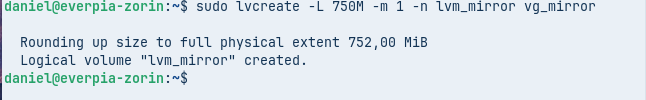

Comprovem que la còpia està sincronitzada i en quins discs és:

```bash
sudo lvs -a -o +devices vg_mirror
```

- `-a` mostra també les parts internes del mirall (les còpies i el registre).
- `-o +devices` afegeix la columna amb els discs on és cada part.
- La columna **Cpy%Sync** ha d'estar a 100,00 perquè la còpia estigui completa.

El resultat mostra que les dades estan a `/dev/sdd` i `/dev/sde`.

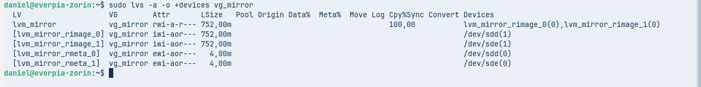

## 10. Volum lvm_dades, snapshot i restauració

### 10.1 Afegir dos discs al grup vg1

L'enunciat demana afegir dos discs nous al grup de volums. Els discs `EverPia-LVM-Disco5` i `EverPia-LVM-Disco6` apareixen com a `sdf` i `sdg`.

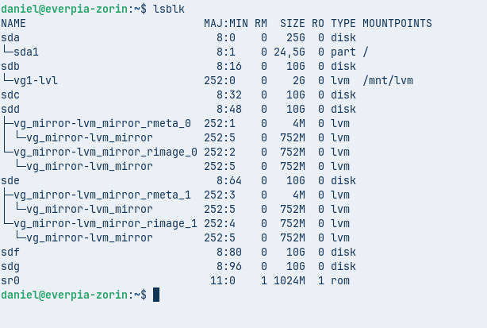

```bash
sudo pvcreate /dev/sdf
sudo pvcreate /dev/sdg
sudo vgextend vg1 /dev/sdf /dev/sdg
sudo vgs
```

- `vgextend` afegeix volums físics a un grup existent.
- Després de l'ampliació, `vg1` té 4 PV i uns 39,98 GB de capacitat, amb 37,98 GB lliures.

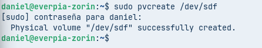

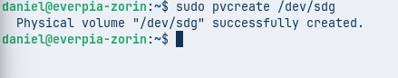

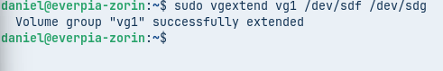

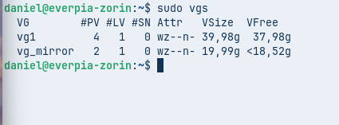

### 10.2 Crear el volum lvm_dades

Segons l'enunciat, `lvm_dades` es crea amb el **primer disc afegit** (`sdf`). El segon (`sdg`) es reserva per al snapshot.

```bash
sudo lvcreate -L 5G -n lvm_dades vg1 /dev/sdf
```

- `/dev/sdf` indica el disc on es reserva el volum.

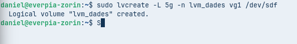

Formatem el volum i creem el punt de muntatge:

```bash
sudo mkfs.ext4 /dev/vg1/lvm_dades
sudo mkdir -p /mnt/lvm_dades
sudo mount /dev/vg1/lvm_dades /mnt/lvm_dades
```

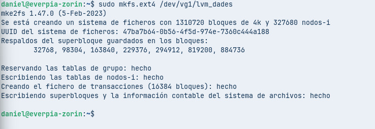

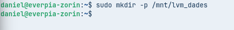

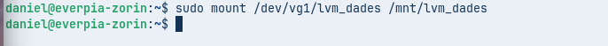

El muntatge automàtic es fa com amb `lvl`, afegint a `/etc/fstab` la línia següent:

```text
/dev/vg1/lvl /mnt/lvm ext4 defaults 0 0
/dev/vg1/lvm_dades /mnt/lvm_dades ext4 defaults 0 0
```


```bash
sudo mount -av
```

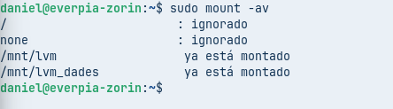

### 10.3 Guardar fitxers al volum

Primer creem un fitxer de text per comprovar l'escriptura:

```bash
echo "Prova de dades a lvm_dades" | sudo tee /mnt/lvm_dades/prova.txt
ls -l /mnt/lvm_dades
```

- `tee` escriu el text al fitxer i el mostra per pantalla. Com que la carpeta és de `root`, no es pot usar `sudo echo ... >`.

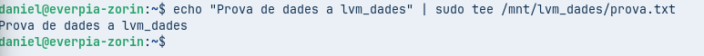

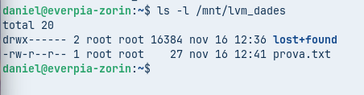

Després guardem imatges d'Internet. El navegador va guardar primer **pàgines web** (`.html`) en lloc de les imatges, per això cal desar la imatge directament (clic dret sobre la foto → *Desa la imatge com*). Un cop tenim les imatges a `~/Descargas`, les copiem:

```bash
sudo cp ~/Descargas/*.jpg /mnt/lvm_dades/
ls -l /mnt/lvm_dades
```

- `~/Descargas/*.jpg` selecciona totes les imatges `.jpg` de la carpeta.

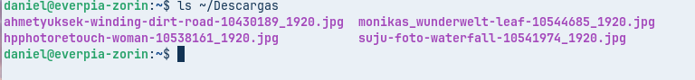

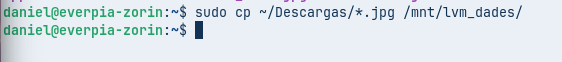

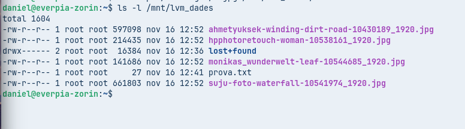

### 10.4 Crear el snapshot

El snapshot és una còpia de l'estat del volum en un moment determinat. Usem el segon disc afegit (`sdg`) per guardar els canvis posteriors.

```bash
sudo lvcreate -L 2G -s -n lv_snapshot /dev/vg1/lvm_dades /dev/sdg
```

- `-s` indica que és un snapshot.
- `-L 2G` és l'espai per guardar els canvis. És un 40 % de la mida de `lvm_dades`, dins del rang recomanat (10–50 %).
- `-n lv_snapshot` és el nom que demana l'enunciat.
- `/dev/vg1/lvm_dades` és el volum original.
- `/dev/sdg` és el disc on es reserva el snapshot.

> **Incidència:** la primera vegada es va escriure `-l 2g` (minúscula). Aquesta opció indica un nombre d'extensions, no una mida, i LVM la va rebutjar. S'ha corregit a `-L 2G`.

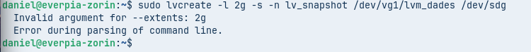

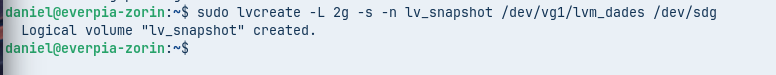

Comprovem l'origen i el disc de cada volum. Cal escriure la llista de columnes **sense espais**:

```bash
sudo lvs -o lv_name,origin,lv_size,devices vg1
```

- `origin` mostra de quin volum és snapshot.

La sortida mostra `lv_snapshot` amb origen `lvm_dades`, 2,00 GB, a `/dev/sdg`. `lvm_dades` té 5,00 GB i està a `/dev/sdf`.

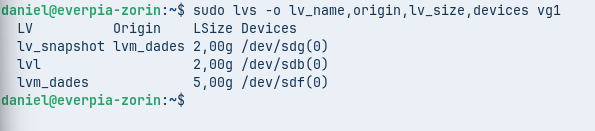

### 10.5 Simular un dany i restaurar

Simulem la pèrdua de dades esborrant el fitxer de prova:

```bash
sudo rm /mnt/lvm_dades/prova.txt
ls -l /mnt/lvm_dades
```

El snapshot conserva l'estat del moment en què es va crear, de manera que encara té `prova.txt`.

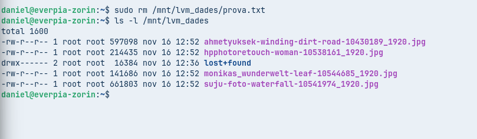

Per restaurar, cal desmuntar el volum primer:

```bash
sudo umount /mnt/lvm_dades
```

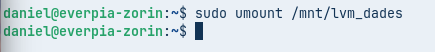

Ara fusionem el snapshot amb el volum original:

```bash
sudo lvconvert --merge /dev/vg1/lv_snapshot
```

- `lvconvert --merge` aplica al volum original l'estat guardat al snapshot.
- En acabar, LVM elimina el snapshot, perquè ja s'ha aplicat.

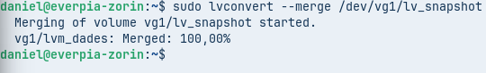

Tornem a muntar el volum. Surt un avís perquè `/etc/fstab` s'ha modificat i systemd encara té la versió antiga. Es recarrega amb:

```bash
sudo mount /dev/vg1/lvm_dades /mnt/lvm_dades
sudo systemctl daemon-reload
ls -l /mnt/lvm_dades
```

- `systemctl daemon-reload` fa que systemd llegeixi la versió actual de `fstab`.

Després de la restauració hi tornen a ser `prova.txt` i les imatges.

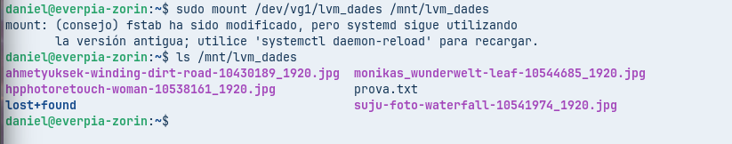

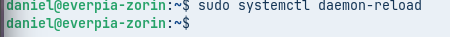

## 11. Ampliació de lvm_dades

L'ampliació usa l'espai lliure de `vg1`. Primer comprovem quant espai hi ha:

```bash
sudo vgs vg1
```

Hi ha 32,98 GB lliures.


Desmuntem el volum, perquè la guia indica que cal fer-ho abans de modificar-lo:

```bash
sudo umount /mnt/lvm_dades
```


Ampliem el volum lògic 5 GB:

```bash
sudo lvextend -L +5G /dev/vg1/lvm_dades
```

- `-L +5G` afegeix 5 GB als 5 GB actuals. El volum passa a 10 GB.


Abans de redimensionar el sistema de fitxers, el revisem:

```bash
sudo e2fsck -f /dev/vg1/lvm_dades
```

- `e2fsck` revisa el sistema de fitxers.
- `-f` força la revisió.


Ara el sistema de fitxers ocupa tot l'espai del volum:

```bash
sudo resize2fs /dev/vg1/lvm_dades
```

- `resize2fs` redimensiona el sistema de fitxers ext4 a la mida del volum. Sense un nombre, usa tot l'espai disponible.


Tornem a muntar el volum i comprovem la mida:

```bash
sudo mount /dev/vg1/lvm_dades /mnt/lvm_dades
df -h /mnt/lvm_dades
```


El resultat és un volum de 9,8 GB (la diferència respecte a 10 GB és la reserva del sistema de fitxers), amb 1,6 MB usats i 9,3 GB lliures.


## 12. Comprovació després del reinici

Per confirmar que el muntatge automàtic de `lvm_dades` funciona, la màquina es reinicia. Després, s'ha comprovat amb `uptime -p`, que mostra el temps des de l'últim arrencament, i amb `df`:

```bash
uptime -p
df -h /mnt/lvm_dades
```

El sistema porta un minut encendit i el volum apareix muntat a `/mnt/lvm_dades` sense cap comanda de muntatge manual.


---

## 13. Resum de la part de Linux

| Apartat de l'enunciat | Resultat |
|---|---|
| Crear VG i LV amb dos discs de 10 GB | `vg1` amb `sdb` i `sdc`, i el volum `lvl` de 2 GB |
| Format i muntatge automàtic | `lvl` formatat en ext4, muntat a `/mnt/lvm` i afegit a `/etc/fstab` |
| Mirall (`lvm_mirror`) | Creat a `vg_mirror` amb `sdd` i `sde`, sincronitzat al 100 % |
| Dos discs nous al grup i volum `lvm_dades` | `sdf` i `sdg` afegits a `vg1`; `lvm_dades` de 5 GB a `sdf` |
| Snapshot (`lv_snapshot`) | Creat amb 2 GB a `sdg` sobre `lvm_dades` |
| Restauració del snapshot | Fitxer esborrat, `lvconvert --merge` i fitxer recuperat |
| Ampliació | `lvm_dades` passa de 5 GB a 10 GB amb l'espai lliure de `vg1` |

### Notes

- L'enunciat fa servir els noms `lvm_dades` i `lv_dades`. S'ha usat **`lvm_dades`** de manera coherent en tota la part de Linux.
- El mirall s'ha creat a `vg_mirror` amb els discs nous, per la raó explicada a l'apartat 9. El nom de la guia (`lv_mirror`) s'ha canviat per `lvm_mirror`, que és el que demana l'enunciat.
- Les proves de fallada d'un disc (desconnectar un disc del mirall) no formen part de la guia de LVM. Aquesta prova apareix a la guia de Windows, amb Storage Spaces.
