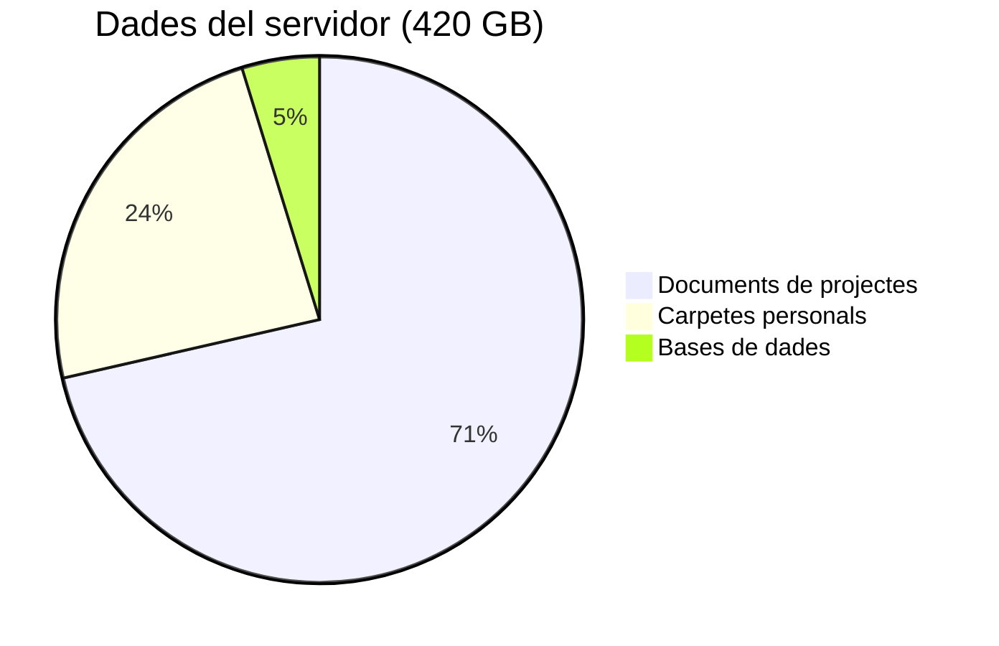
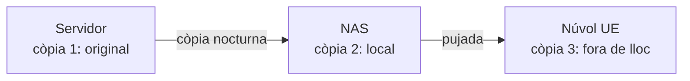

# DRP: Pla de còpies

### Fase 1 · Respostes individuals

**Cas:** Muntatges i Serveis Tècnics SL · **Alumne:** Daniel Gallardo Rodríguez

---

<b>Dades del cas (clica per desplegar)</b>

 

| Element | Mida | Característiques |
|---|---|---|
| Bases de dades (comptabilitat i clients) | 20 GB | Ús diari, canvi constant |
| Documents de projectes | 300 GB | Plànols i especificacions, creixement moderat |
| Carpetes personals | 100 GB | Feina diària dels usuaris |
| Equips clients | 10 | Windows 11 |
| Connexió | 600 Mbps | Fibra simètrica |

---

## 1. Què copiar?

Les dades més crítiques són les bases de dades de comptabilitat i clients. Només ocupen 20 GB, però s'usen cada dia, canvien tot el temps i són les úniques amb un RPO i un RTO de 4 hores. Si es perden, l'empresa no pot facturar ni atendre els clients.

Després vénen els documents de projectes (300 GB). Són els plànols i les especificacions tècniques, que és la feina de l'empresa, i costaria molt tornar-los a fer. Les carpetes personals (100 GB) també es copien, però aquí és assumible perdre un dia de feina.

| Prioritat | Dades | Motiu |
|:---:|---|---|
| **1** | Bases de dades | RPO i RTO de 4 h, canvi constant |
| **2** | Documents de projectes | Són la feina de l'empresa, difícils de refer |
| **3** | Carpetes personals | RPO de 24 h, es pot perdre un dia |
| **4** | Configuració del servidor | Ocupa gairebé res i ajuda a reinstal·lar |

També copiaria la configuració del servidor (`/etc` i les tasques programades). Ocupa molt poc i ajuda si cal reinstal·lar-lo.

### Cal copiar els 10 equips?

Dels 10 equips no faria còpia completa. Els usuaris treballen sobretot amb fitxers del servidor i Windows 11 es pot tornar a instal·lar. El problema són els tècnics que deixen informes a la carpeta Documents, perquè això sí es perdria si l'equip falla.

> [!TIP]
> Copiaria només la carpeta **Documents** cap al servidor cada nit (per exemple amb `robocopy`), i així entra a la còpia normal del servidor.

---

## 2. Periodicitat i tipus de còpia

Per a les bases de dades faria una còpia **completa** cada nit i una **diferencial** cada 2 hores durant la jornada. El RPO és de 4 hores, i amb 2 hores si una còpia falla encara no se supera. Trio la diferencial perquè per restaurar només calen dues peces (la completa i l'última diferencial), i això ajuda a complir el RTO de 4 hores.

Per als projectes i les carpetes personals, una còpia **completa** cada diumenge i una **incremental** cada nit. Canvien poc i el RPO és de 24 hores, així que la incremental és suficient i triga poc.

Per complir la retenció d'un mes es guarden 5 còpies completes setmanals.

### Calendari bàsic

| Dia | Bases de dades | Projectes i carpetes personals |
|---|---|---|
| **De dilluns a divendres** | Completa a la nit + diferencial cada 2 h de 10:00 a 18:00 | Incremental a la nit |
| **Dissabte** | Completa a la nit | Només es verifiquen les còpies |
| **Diumenge** | Completa a la nit | **Completa setmanal** |

---

## 3. Mitjans i ubicació

Com a mitjà local usaria un **NAS**, i com a mitjà extern el **núvol**.

| Mitjà | Decisió | Motiu |
|---|:---:|---|
| NAS | Mitjà local | Ràpid per restaurar, ajuda a complir el RTO |
| Núvol | Mitjà extern | Còpia fora de lloc |
| Discs USB | Complement | Depenen que algú els connecti i els canviï |
| Cintes | Descartades | Massa cares i complicades per a 10 equips |

> [!IMPORTANT]
> El motiu de tenir les dues coses és el temps de recuperació. Amb la fibra de 600 Mbps (uns 75 MB/s com a màxim) restaurar les bases de dades des del núvol són uns **5 minuts**, però restaurar els 420 GB sencers trigaria **més d'una hora i mitja**, i a la pràctica bastant més. Per això la font principal per restaurar és el NAS, i el núvol queda per si passa un desastre a l'oficina.

### Regla 3-2-1

- **3 còpies:** l'original al servidor, una còpia al NAS i una al núvol.
- **2 mitjans:** disc local i núvol.
- **1 fora de lloc:** el núvol.

La còpia més recent la guardaria al NAS, en una sala diferent de la del servidor perquè un mateix problema no afecti les dues coses. La còpia externa es guarda al núvol, a un centre de dades de la Unió Europea i xifrada.
