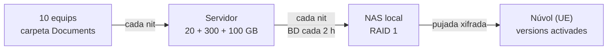

# DRP: Pla de còpies

### Fase 2 · Proposta unificada

**RPO** 4 h · **RTO** 4 h · **Regla** 3-2-1

**Cas:** Muntatges i Serveis Tècnics SL · **Alumne:** Daniel Gallardo Rodríguez

---

## Esquema 3-2-1

| Element | Proposta unificada | Justificació |
|---|---|---|
| **Dades crítiques** | Bases de dades de comptabilitat i clients. Després, documents de projectes i carpetes personals | Les bases de dades tenen el RPO i el RTO de 4 h. Els projectes són la feina de l'empresa |
| **Periodicitat** | Bases de dades cada 2 h en horari laboral. La resta, cada nit | Amb 2 h hi ha marge sobre el RPO de 4 h si una còpia falla |
| **Tipus de còpia** | Bases de dades: completa + diferencial. La resta: completa setmanal + incremental | La diferencial és més ràpida de restaurar, i la incremental és petita |
| **Mitjà 1 (local)** | NAS amb RAID 1, en una sala diferent del servidor | És ràpid per restaurar i ajuda a complir el RTO |
| **Mitjà 2 (extern)** | Núvol a la Unió Europea, xifrat | Còpia fora de lloc davant d'un incendi, un robatori o un ransomware |

### Vista general

---

## Notes

> [!NOTE]
> Aquesta part de l'activitat està pensada per fer-se en grup. L'he fet jo sol perquè no tinc company de grup. Per això no hi ha una discussió ni un consens amb altres persones, i la proposta parteix directament de les meves respostes individuals de la Fase 1.
