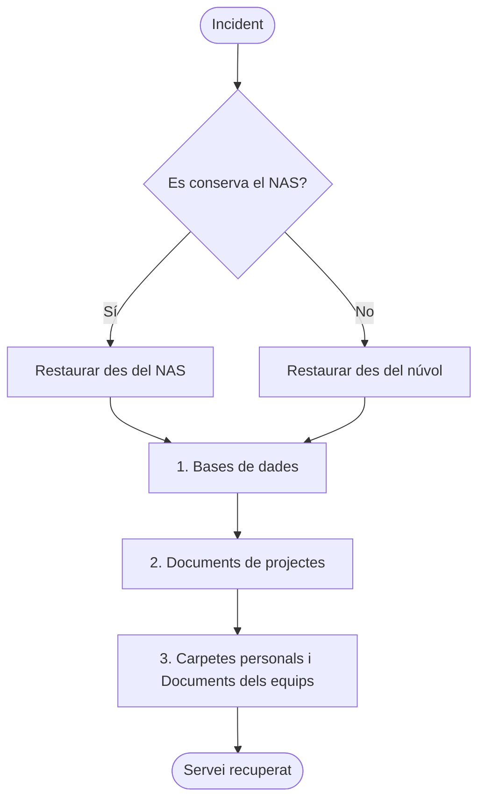

<div align="center">

# DRP: Pla de còpies

### Fase 3 · Proposta final


**Cas:** Muntatges i Serveis Tècnics SL · **Alumne:** Daniel Gallardo Rodríguez

</div>

---

## Dades objecte de la còpia

### Dades crítiques

| Dades | Mida | Freqüència |
|---|---|---|
| Bases de dades de comptabilitat i clients | 20 GB | Cada 2 h en horari laboral i completa cada nit |
| Documents de projectes | 300 GB | Incremental cada nit i completa cada diumenge |

### Dades no crítiques

| Dades | Mida | Freqüència |
|---|---|---|
| Carpetes personals | 100 GB | Incremental cada nit i completa cada diumenge |
| Carpeta Documents dels 10 equips | Petita | Cada nit cap al servidor |
| Configuració del servidor | Molt petita | Cada setmana |

> [!NOTE]
> No es copien el sistema operatiu, els programes ni els fitxers temporals.

---

## Cronograma setmanal

La jornada és de dilluns a divendres, de 8:00 a 18:00. Després de cada còpia local es puja una còpia al núvol.

| Dia | Dades | Tipus de còpia | Mitjà |
|---|---|---|---|
| **Dilluns** | Bases de dades a les 10, 12, 14, 16 i 18 h. Completa a les 21 h | Diferencial i completa | NAS i núvol |
| | Projectes, carpetes personals i Documents dels equips, a les 22 h | Incremental | NAS i núvol |
| **Dimarts** | Igual que dilluns | Igual que dilluns | NAS i núvol |
| **Dimecres** | Igual que dilluns | Igual que dilluns | NAS i núvol |
| **Dijous** | Igual que dilluns | Igual que dilluns | NAS i núvol |
| **Divendres** | Igual que dilluns | Igual que dilluns | NAS i núvol |
| **Dissabte** | Bases de dades a les 21 h. Verificació de les còpies de la setmana | Completa | NAS i núvol |
| **Diumenge** | Bases de dades a les 21 h. Tot el servidor i la configuració a les 22 h | **Completa setmanal** | NAS i núvol |

### Un dia laborable de les bases de dades

```mermaid
timeline
    title Còpies de les bases de dades (de dilluns a divendres)
    08:00 : Inici de la jornada
    10:00 : Diferencial
    12:00 : Diferencial
    14:00 : Diferencial
    16:00 : Diferencial
    18:00 : Diferencial : Fi de la jornada
    21:00 : Completa nocturna
    22:00 : Incremental de fitxers
```

> [!NOTE]
> La completa setmanal (uns 420 GB) tarda unes quantes hores a pujar al núvol, així que s'acaba de pujar la matinada de dilluns.

---

## Mitjans i ubicació

| Mitjà | Detall |
|---|---|
| **Mitjà 1 (local)** | NAS de dues badies amb discs en RAID 1, d'uns 6 TB útils. Va en una sala diferent de la del servidor i ben tancada |
| **Mitjà 2 (extern)** | Emmagatzematge al núvol, per exemple Azure Blob Storage o Backblaze B2, a una regió de la Unió Europea. Les dades es xifren abans de sortir de l'empresa i s'activen les versions perquè un ransomware no pugui esborrar les còpies antigues |
| **Responsable** | El tècnic d'informàtica de l'empresa o el proveïdor de serveis informàtics. Ha de mirar cada dia si les còpies s'han fet bé |

> [!WARNING]
> La clau de xifratge es guarda **fora del servidor**. Sense ella no es pot restaurar res del núvol.

### Retenció i espai

| Còpia | Es conserva |
|---|---|
| Completes setmanals | 5 setmanes |
| Diàries | 35 dies |
| Completes mensuals (núvol) | 3 mesos |

Això dona més d'un mes d'historial. Amb un 5 % de canvi diari calculo uns **3,3 TB** en total, i amb 6 TB útils al NAS n'hi ha prou.

---

## Estratègia de recuperació

### RPO de 4 hores

Les bases de dades es copien cada 2 hores, per tant en el pitjor cas es perden menys de 2 hores de feina. Si una còpia falla, es pot arribar a 4 hores, que és el límit. Les còpies es fan amb un volcat consistent de la base de dades perquè no es copiï mentre s'està escrivint, i si una còpia falla salta un avís.

### RTO de 4 hores

Són temps estimats, perquè cal afegir el que costi detectar el problema i preparar el servidor.

| Escenari | Font | Temps estimat |
|---|---|---|
| Falla un disc o es corromp la base de dades | NAS (20 GB per xarxa local, uns 3 minuts) | Menys d'1 hora |
| Es perd el servidor i el NAS continua | NAS, més reinstal·lar el servidor | 1–2 hores |
| Desastre a l'oficina, es perd tot | Núvol (20 GB, uns 5 minuts en el millor cas) | 2–3 hores |



Si cal restaurar tot el servidor, s'ordena per prioritat: primer les bases de dades, després els projectes i al final les carpetes personals. Així les dades que tenen el RTO de 4 hores són les primeres a tornar.

<details>
<summary><b>Procediment per restaurar les bases de dades (clica per desplegar)</b></summary>

<br>

1. Aturar la base de dades i mirar quina és la causa de la fallada.
2. Restaurar l'última còpia completa.
3. Aplicar l'última còpia diferencial.
4. Comprovar que les dades estan bé i avisar els usuaris.

</details>

### Proves i manteniment

- [ ] **Cada mes:** prova de restauració en un entorn de prova. Una còpia que no s'ha provat de restaurar no es pot donar per bona.
- [ ] **Cada dissabte:** verificació de la integritat de les còpies.
- [ ] **Sempre:** el procediment queda escrit perquè el pugui seguir una altra persona.

---

## Notes

> [!NOTE]
> Aquesta part de l'activitat està pensada per fer-se en grup. L'he fet jo sol perquè no tinc company de grup. Per això no hi ha una discussió ni un consens amb altres persones, i la proposta parteix directament de les meves respostes individuals de la Fase 1.
